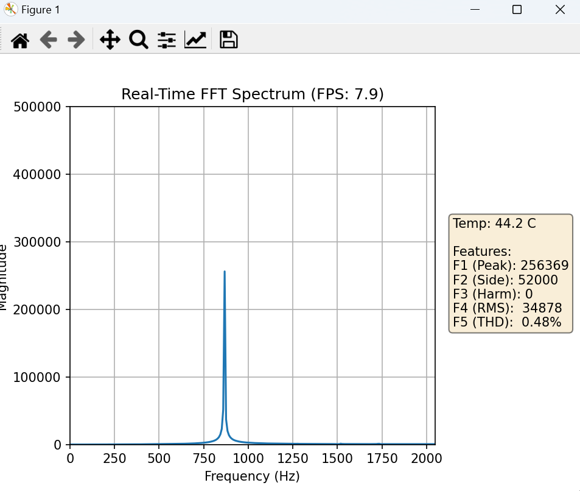

# STM32 실시간 FFT 분석기 📊

 

STM32F103 마이크로컨트롤러에서 고성능 실시간 고속 푸리에 변환(FFT) 구현 프로젝트입니다. 이 프로젝트는 ADC와 DMA를 사용하여 아날로그 신호를 캡처하고 CMSIS-DSP 라이브러리를 사용하여 주파수 성분을 효율적으로 분석하는 방법을 보여줍니다.

## 🚀 주요 기능

*   **실시간 처리**: **이중 버퍼링(Ping-Pong)**과 DMA를 활용하여 연속 샘플링 중 데이터 손실 없음.
*   **DMA vs 폴링 비교**: DMA 및 폴링 모드 간 전환 가능한 컴파일 타임 스위치로 신호 분석에 대한 "블라인드 타임"의 영향을 시연.
*   **높은 정밀도**: ARM CMSIS-DSP를 사용하여 512포인트 부동소수점 RFFT(실수 FFT) 구현.
*   **이중 채널 모니터링**: ADC 스캔 모드를 사용하여 **신호(CH0)**와 **온도(CH1)**를 동시에 캡처.
*   **라이브 모니터링**: UART를 통해 피크 주파수, 크기 및 온도를 출력하여 PC에서 실시간 분석 가능.
*   **성능 검증**: 샘플링 주기 내에서 실행되도록 최적화 (처리 시간 < 110ms @ 4.6kHz 샘플링).
*   **안전성 우선**: DMA 인터럽트와 메인 루프 처리 간의 경합을 방지하기 위한 임계 섹션 처리 포함.
*   **A-to-B 통신**: 5가지 핵심 기능(피크, 사이드밴드, 고조파, RMS, THD)을 추출하고 **SPI**를 통해 다른 STM32 보드로 전송.
*   **Python 시각화기**: 실시간 스펙트럼 분석 및 기능 모니터링(F1~F5)을 위한 맞춤형 Python 스크립트.

## 📊 결과 시각화



*   **실시간 스펙트럼**: 860Hz 정현파 입력.
*   **기능 추출**:
    *   **F1 (피크)**: 기본 주파수 크기.
    *   **F2 (사이드밴드)**: 최대 사이드밴드 크기.
    *   **F3 (고조파)**: 3차 고조파 크기 (나이퀴스트 초과 시 0).
    *   **F4 (RMS)**: 시간 영역 RMS.
    *   **F5 (THD)**: 고조파 왜곡률.

## 🛠 하드웨어 요구사항

*   **MCU**: STM32F103RB (Nucleo-F103RB 또는 동등 제품)
*   **입력**: 아날로그 신호 생성기 (정현파/구형파)
*   **디버그**: USB-to-UART 변환기 (또는 ST-Link VCOM)
*   **측정**: 오실로스코프 (타이밍 검증용)

### 핀 구성
| 핀 | 기능 | 설명 |
| :--- | :--- | :--- |
| **PA0** | ADC_IN0 | 아날로그 신호 입력 (0V ~ 3.3V) |
| **PA1** | ADC_IN1 | 온도 센서 입력 (예: LM35) |
| **PA2** | USART2_TX | UART 디버그 출력 (115200 bps / 460800 bps) |
| **PA3** | USART2_RX | UART 디버그 입력 |
| **PA5** | LD2 (LED) | 타이밍 측정 / 상태 LED |
| **PB13** | SPI2_SCK | SPI 클록 출력 (마스터) |
| **PB14** | SPI2_MISO | SPI 데이터 입력 (마스터) |
| **PB15** | SPI2_MOSI | SPI 데이터 출력 (마스터) |
| **PB12** | SPI2_NSS | SPI 칩 선택 (소프트웨어 제어) |

> [!WARNING]
> **입력 전압 경고**: ADC 입력 범위는 **0V ~ 3.3V**입니다. 음수 전압이나 3.3V를 초과하는 전압을 적용하지 마세요. 신호에 적절한 DC 오프셋(예: 1.65V)이 있는지 확인하세요.

## 💻 소프트웨어 요구사항

*   **IDE**: STM32CubeIDE (v1.10.0 이상 권장)
*   **라이브러리**: ARM CMSIS-DSP 라이브러리 (미리 컴파일된 라이브 필요)

## ⚙️ 설치 및 빌드

1.  **저장소 복제**
    ```bash
    git clone https://github.com/Adaptive-MCSA-Redundancy-System/STM32_A-FFT.git
    ```

2.  **STM32CubeIDE로 가져오기**
    *   `File` -> `Import` -> `Existing Projects into Workspace` -> 프로젝트 디렉토리 선택.

3.  **CMSIS-DSP 라이브러리 연결**
    *   `libarm_cortexM3l_math.a`가 연결되어 있는지 확인하세요.
    *   `Project Properties` -> `C/C++ Build` -> `Settings` -> `MCU GCC Linker` -> `Libraries`로 이동.
    *   라이브러리에 `arm_cortexM3l_math` 추가 (-l).
    *   라이브러리 경로를 검색 경로에 추가 (-L).

4.  **빌드 및 플래시**
    *   **망치** 아이콘을 클릭하여 빌드.
    *   **실행/디버그** 아이콘을 클릭하여 STM32 보드에 펌웨어를 플래시.

## 📖 사용 방법

1.  **하드웨어 연결**: 신호 생성기를 **PA0**과 **GND**에 연결.
2.  **터미널 열기**: 보드를 PC에 연결하고 시리얼 터미널(Tera Term, PuTTY)을 열기.
    *   보드 레이트: **115200**
    *   데이터: 8비트, 패리티: 없음, 정지 비트: 1
3.  **실행**: 보드를 재설정하면 피크 주파수 출력을 볼 수 있음:
    ```text
    Peak: 1000.0 Hz, Mag: 45000, Temp: 25.5 C
    Peak: 1000.0 Hz, Mag: 44950, Temp: 25.6 C
    ...
    ```
4.  **타이밍 검증**: 오실로스코프로 **PA5**를 탐사. 높은 펄스 폭은 FFT 계산 시간을 나타냄.

## 🔬 실험: DMA vs 폴링

DMA 및 폴링 모드 간을 전환하여 실시간 시스템에서 DMA의 중요성을 관찰할 수 있습니다.

1.  `Core/Src/main.c`를 엽니다.
2.  `USE_DMA` 매크로를 수정합니다:
    ```c
    #define USE_DMA 1 // 1: DMA 모드 (데이터 손실 없음), 0: 폴링 모드 (데이터 손실)
    ```
3.  **DMA 모드 (`1`)**:
    *   ADC는 백그라운드에서 DMA를 통해 버퍼에 기록.
    *   CPU는 동시에 버퍼의 다른 절반을 처리.
    *   **결과**: 연속 모니터링, 블라인드 스팟 없음.
4.  **폴링 모드 (`0`)**:
    *   CPU는 ADC 변환을 기다리는 바쁜 대기.
    *   CPU가 FFT를 처리하는 동안 ADC 캡처 중지 (블라인드 타임 ~42ms).
    *   **결과**: 신호 업데이트가 느림 (~264ms 주기) 및 처리 중 데이터 손실.

### 4. 실험 결과 (관찰됨)
| 기능 | DMA 켜짐 (`USE_DMA 1`) | DMA 꺼짐 (`USE_DMA 0`) |
| :--- | :--- | :--- |
| **FPS (업데이트 속도)** | **안정적 ~4.0 FPS** (최대 5.7) | **불안정 1.9 ~ 4.0 FPS** |
| **신호 연속성** | 부드럽고 연속적인 이동 | 버퍼링되고 "텔레포팅되는" 피크 |
| **블라인드 타임** | **영** (0ms) | **프레임당 ~50ms** |

> **분석**:
> 최대 FPS가 물리적 샘플링 시간으로 제한되더라도(~220ms), **DMA 모드**는 데이터 획득이 절대 중지되지 않기 때문에 안정적인 프레임 속도를 유지합니다.
> **폴링 모드**는 CPU가 FFT를 처리하는 동안 데이터 캡처를 중지하여 상당한 프레임 드롭(1.9 FPS로 낮아짐)을 겪으므로, 신호 변화가 완전히 누락되는 "블라인드 타임"이 발생합니다.

## 🧠 기술 세부사항

### 이중 버퍼링(Ping-Pong)
실시간 성능을 달성하기 위해 `2 * FFT_LEN`의 버퍼 크기를 사용합니다.
*   **반 완료 인터럽트**: 첫 번째 절반이 가득 찰 때 트리거. CPU는 첫 번째 절반을 처리하는 동안 DMA는 두 번째 절반을 채움.
*   **전체 완료 인터럽트**: 두 번째 절반이 가득 찰 때 트리거. CPU는 두 번째 절반을 처리하는 동안 DMA는 첫 번째 절반을 채움 (순환 모드).

### 신호 처리 체인
1.  **ADC 캡처**: 12비트 샘플 @ ~4.1kHz (4096Hz).
    *   **스캔 모드**: CH0 (신호)과 CH1 (온도)을 순차적으로 캡처.
    *   **FFT 길이**: 512 샘플 (RAM의 이중 채널 버퍼링을 수용하기 위해 1024에서 감소).
    *   **해상도**: 빈당 ~8 Hz.
2.  **정수-부동소수점**: `uint16_t`를 `float32_t`로 변환.
3.  **RFFT**: `arm_rfft_fast_f32`를 사용하여 실수 FFT 계산.
4.  **크기**: `sqrt(Re^2 + Im^2)` 계산.
5.  **피크 검색**: 최대 크기를 가진 빈 찾기 (DC 무시).
